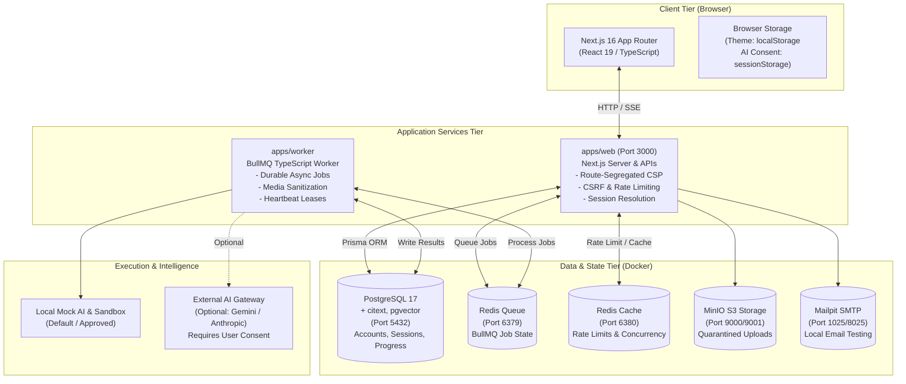

# JavaVerse

> **Local-First, Provider-Neutral Java 21 Learning Platform**
> _JavaVerse is source-visible and preparing for open-source release._

[](https://nodejs.org)
[](https://pnpm.io)
[](https://www.postgresql.org)
[](https://redis.io)
[-black.svg>)](https://nextjs.org)
[](#licence-status)

---

## 1. Development Status & Platform Notice

> [!WARNING]
> **Non-Production Self-Hosting Notice**
> JavaVerse is source-visible and preparing for open-source release. The platform is architected exclusively for **local deployment and single-installation self-hosting**. It is **not approved for public multi-tenant production hosting**.
>
> All accounts possess identical learner capabilities (strictly capped at 5 active accounts per installation). The execution sandbox defaults strictly to **Local Mock** (`SANDBOX_PROVIDER=mock`); container-based execution (`container_runner`) remains **REJECTED** pending dedicated security containment review.

---

## 2. Overview

**JavaVerse** is an open-source, local-first Java learning platform engineered for structured conceptual mastery. Rather than acting as a generic code sandbox or a thin AI wrapper, JavaVerse combines visual mental models, interactive JVM state stepping, progressive curriculum challenges, and transparent AI tutoring.

Learners explore Java 21 fundamentals from foundational syntax to object-oriented architecture, collections, concurrency, and JVM memory mechanics. All progress, chats, and code solutions remain locally owned on your installation.

---

## 3. Current Status Table

| Architecture Dimension       | Current State                             | Authoritative Policy                              |
| :--------------------------- | :---------------------------------------- | :------------------------------------------------ |
| **Product Topology**         | Local-First Monorepo (`pnpm` + Turborepo) | Pinned Node `>=24.22.1`, pnpm `12.15.0`           |
| **Account Model**            | **Single Learner Account**                | All accounts have identical learner capabilities  |
| **Installation Capacity**    | **5 Active Accounts**                     | Enforced atomically via PostgreSQL advisory lock  |
| **Sign-Up Flow**             | **Public Local Registration**             | Open local registration; no invitations or tokens |
| **Credential Security**      | **Argon2id Password Hashing**             | Memory-hard (`m=65536, t=3, p=4`); no plaintext   |
| **Database System**          | **PostgreSQL 17 (`pgvector`)**            | Installation-specific primary system of record    |
| **Cache & Queues**           | **Redis 7 (Isolated Queue + Cache)**      | Dedicated BullMQ queue and ephemeral cache        |
| **AI Gateway**               | **Local Mock by Default** (`mock`)        | Zero external tokens; optional Gemini/Anthropic   |
| **Execution Sandbox**        | **Local Mock** (`mock`)                   | `container_runner` is **REJECTED**                |
| **Static Hash Verification** | **Deterministic CSP Hashes**              | Enforced via `pnpm verify:static-hashes`          |
| **Licence Status**           | **Preparing for Open Source**             | Root `LICENSE` pending maintainer selection (P0)  |
| **Production Hosting**       | **Unapproved**                            | Local self-hosting and development only           |

---

## 4. Feature Set

### 4.1 Learning Features

- **12 Visual Curriculum Lessons**: Spanning Java 21 variables, control flow, methods, arrays, classes, interfaces, exceptions, generics, collections, streams, lambdas, and JVM memory.
- **Progressive Concept Unlocking**: Interactive checkpoints and quizzes validating understanding before advancement.
- **Zero-Progress Baseline**: Freshly registered accounts initialize with 0% overall progress, 0 XP, 0-day streak, and zero completed lessons.

### 4.2 Practice Engine

- **Coding Challenges**: Multi-tier interactive Java programming problems.
- **Execution Feedback**: Instant compilation and execution feedback powered safely by the approved Local Mock execution provider.
- **Mastery Tracking**: Automated streak tracking, XP awards, and completion metrics with strict database-level unique constraints.

### 4.3 Accessible Concept Visualizations

- **12 Canonical Visualizer Modes**: Array, Stack, Queue, LinkedList, Binary Tree, Heap, Graph, Hash Table, Recursion, JVM Memory (2D & 3D), Two-Pointer, and String Manipulation.
- **WCAG 2.2 AA Compliant**: Every visualization provides full keyboard navigation, playback controls, `aria-live` step narrations, and semantic HTML fallback tables exposing full variable states.
- **Motion Sensitivity**: Respects `prefers-reduced-motion` to disable animations for sensitive learners.

### 4.4 Ask JavaVerse (AI Tutor)

- **Multi-Slot Chat Interface**: Maintain up to 3 concurrent, persistent learning conversations.
- **Transparent AI Banner**: Displays the active AI provider, model name, and execution mode clearly in the header.
- **External-AI Consent**: Requires explicit per-session user consent before transmitting queries to external providers (Gemini or Anthropic).
- **Token-Usage Transparency**: Real-time display indicating `Local Mock · No external token usage` in mock mode, or verified token metrics when using external APIs.
- **PII Scrubbing**: Automatic client-side and server-side redacting of email addresses, IP addresses, URLs, phone numbers, and secrets.

### 4.5 Accounts & Settings

- **Uniform Learner Accounts**: Every account enjoys complete access to learning modules, practice problems, and settings.
- **Session Management**: View all active browser sessions with IP and user-agent metadata; revoke individual sessions or all other sessions.
- **Multi-Factor Authentication (MFA)**: Optional TOTP multi-factor authentication with encrypted recovery codes.
- **Personal Data Export**: One-click download of all personal account progress, chats, and submissions in structured JSON format.

---

## 5. Architecture



---

## 6. Monorepo Package Structure

```text
├── apps/
│   ├── web/               # Next.js 16.4.x App Router application, UI & REST/SSE APIs
│   └── worker/            # BullMQ background job processing daemon
├── packages/
│   ├── db/                # PostgreSQL 17 Prisma ORM schema, migrations, and seeds
│   ├── schemas/           # Shared Zod validation contracts (EnvSchema, Auth, Curriculum)
│   ├── security/          # Argon2id password hashing, tokens, CSP helpers, rate limiting
│   ├── ai/                # Provider-neutral AI gateway (Local Mock, Gemini, Anthropic)
│   └── observability/     # Structured Pino logging, correlation tracing, audit records
├── sandbox/               # Execution interface; Local Mock approved, container runner REJECTED
├── infra/                 # Docker Compose infrastructure configurations
├── scripts/               # Backup, restore, hash verification, and maintenance tooling
└── docs/                  # Project specifications, decisions, operations, and review dossier
```

---

## 7. Local-First Data Ownership & Privacy

JavaVerse is designed from the ground up for personal privacy and data ownership:

1. **Independent Database Isolation**: Each clone of JavaVerse connects strictly to its own configured PostgreSQL database (`javaverse` for manual development/usage; isolated `javaverse_test`, `javaverse_clean_verify`, `javaverse_backup_verify_test` for automated testing). Users who register on your installation exist exclusively in your local database. Zero telemetry or personal data is transmitted to the project maintainer.
2. **PostgreSQL as Source of Truth & Argon2id Password Storage**: PostgreSQL is the sole source of truth for account persistence. Browser password-manager entries are never the source of truth for account existence. Plaintext passwords are never stored and cannot be decrypted or recovered; only memory-hard one-way Argon2id hashes are persisted. If an account's password is unknown, local password reset via Mailpit (`http://localhost:8025`) is the supported recovery path.
3. **Decoupled Account Creation & Sign-in Verification**: Account creation stores the learner account and one-way Argon2id password hash, then redirects to Sign in (`/auth/login?created=1`). JavaVerse does not automatically create an authenticated session after signup. The learner must sign in using the same email and password before accessing the dashboard. Flow: `Signup -> committed account -> Sign in -> authenticated session -> dashboard`.
4. **Logout & Session Revocation**: Logging out atomically invalidates the server session in PostgreSQL and clears the HTTP-only cookie. Session-scoped external-AI consent is removed, while the learner's chosen theme preference is preserved.
5. **Volume Destruction Notice**: All local data is stored in Docker volume `postgres_data`. Running `docker compose down -v` permanently deletes this volume, destroying all local accounts.

---

## 8. Prerequisites

Ensure the following tools are installed on your host machine:

- **Node.js**: `>=24.22.1` (LTS)
- **pnpm**: `>=12.15.0` (Corepack enabled: `corepack enable`)
- **Docker Engine & Docker Compose**: Recent stable version running locally.

---

## 9. Quick Start Guide

### Step 1: Clone and Enter the Repository

```bash
git clone https://github.com/your-org/javaverse.git
cd javaverse
```

### Step 2: Generate Environment Secrets

Generate cryptographically strong secrets into `.env.local`:

```bash
pnpm generate-env
```

### Step 3: Install Pinned Dependencies

Install the exact monorepo dependency graph using the frozen lockfile:

```bash
pnpm install --frozen-lockfile
```

### Step 4: Start Infrastructure Containers

Start background PostgreSQL, Redis, Mailpit, and MinIO services:

```bash
docker compose -f infra/docker-compose.yml up -d
```

### Step 5: Deploy Database Migrations & Seed Content

Deploy schema migrations and seed foundational curriculum lessons:

```bash
pnpm --filter @javaverse/db migrate:deploy
pnpm --filter @javaverse/db seed
```

> [!NOTE]
> **Never run `prisma migrate reset`**. Use `pnpm --filter @javaverse/db migrate:deploy` to apply forward migrations cleanly.

### Step 6: Start JavaVerse

Launch the web application and background worker concurrently:

```bash
./start-dev.sh
```

Or start manually:

```bash
pnpm dev
```

Open **`http://localhost:3000`** in your browser.

---

## 10. First-Use Walkthrough & Manual Verification

1. **Account Creation & Sign In**: Navigate to `http://localhost:3000/auth/signup`. Use any valid unused email and any learner-selected password that satisfies the displayed security policy (at least 12 characters, without leading or trailing spaces; any named email or password in documentation or examples is an optional demonstration example only, not a required credential). JavaVerse does not require predefined domains (`@javaverse.local`, `@example.local`, etc.) or fixed passwords.
   Upon submission, the learner account and one-way Argon2id password hash are committed to PostgreSQL, and the browser redirects to `http://localhost:3000/auth/login?created=1` with an accessible confirmation notice ('Account created successfully. Sign in with your email and password.'). JavaVerse does not automatically create an authenticated session after signup. Enter the same email and password on the Sign in page and submit to create the authenticated session and access the dashboard.
   Flow: `Signup -> committed account -> Sign in -> authenticated session -> dashboard`.
2. **Capacity Enforcement**: JavaVerse permits up to 5 accounts per local installation. All accounts receive identical learner privileges. Manual smoke testing should create only one account unless the project maintainer deliberately chooses otherwise. Do not manually create five permanent development accounts in your primary database; capacity is covered by isolated automated tests.
3. **Verify Baseline Metrics**: The dashboard displays 0% progress, 0 XP, and a 0-day streak.
4. **Theme Preference**: Toggle between Dark and Light mode via the navigation bar. Your preference persists across sessions and restarts.
5. **Ask JavaVerse**: Open the Ask JavaVerse panel, ensure `Local Mock` mode is indicated, and submit a Java query. The response is generated instantly with `Local Mock · No external token usage`.

---

## 11. AI Gateway Configuration

JavaVerse operates in **Local Mock mode by default**:

```env
AI_PROVIDER_PRIMARY=mock
EXTERNAL_AI_ENABLED=false
```

### Optional External Providers

To integrate external intelligence, provide your API key in `.env.local`:

#### Google Gemini

```env
EXTERNAL_AI_ENABLED=true
AI_PROVIDER_PRIMARY=gemini
GEMINI_API_KEY=your_gemini_api_key
GEMINI_MODEL=gemini-2.5-flash
```

#### Anthropic Claude

```env
EXTERNAL_AI_ENABLED=true
AI_PROVIDER_PRIMARY=anthropic
ANTHROPIC_API_KEY=your_anthropic_api_key
ANTHROPIC_MODEL=claude-3-5-sonnet-20241022
```

### AI Safety Safeguards

- **Per-Session Consent**: Learners must click "Authorize for this session" before prompts are forwarded to third-party APIs.
- **Daily Request Quota**: Enforces a default cap of 50 external requests per user per day (`EXTERNAL_AI_DAILY_REQUEST_LIMIT_PER_USER=50`).
- **Global Concurrency Ceiling**: Restricts concurrent external requests to 2 (`EXTERNAL_AI_MAX_CONCURRENCY=2`).
- **Key Isolation**: API keys remain strictly server-side and are never exposed in browser storage, URLs, or client payloads.

---

## 12. Sandbox Policy

- **Approved Provider**: `SANDBOX_PROVIDER=mock` (Local Mock) is the active and approved provider across all environments.
- **Rejected Provider**: Container-based execution (`container_runner`) is an experimental candidate and remains **REJECTED** pending dedicated security containment review.
- Missing or invalid sandbox provider configurations fail closed immediately.
- Client inputs cannot select or activate the rejected provider.
- The UI contains no unsupported verification claims (e.g. absence of "Verified in Sandbox").

---

## 13. Environment Variables Reference

| Variable                                   | Default                      | Required? | Description                                               |
| :----------------------------------------- | :--------------------------- | :-------- | :-------------------------------------------------------- |
| `NODE_ENV`                                 | `development`                | Yes       | Runtime environment (`development`, `test`, `production`) |
| `PORT`                                     | `3000`                       | No        | HTTP port for Next.js web application                     |
| `APP_URL`                                  | `http://localhost:3000`      | No        | Canonical public URL of the web application               |
| `DATABASE_URL`                             | —                            | Yes       | PostgreSQL connection string                              |
| `REDIS_QUEUE_URL`                          | `redis://127.0.0.1:6379`     | Yes       | Redis URL for BullMQ durable jobs                         |
| `REDIS_CACHE_URL`                          | `redis://127.0.0.1:6380`     | Yes       | Redis URL for ephemeral rate limiting and caches          |
| `SESSION_SECRET`                           | —                            | Yes       | 32-byte secret for session cookie encryption              |
| `CURSOR_SIGNING_SECRET`                    | —                            | Yes       | 32-byte secret for pagination cursor HMAC                 |
| `SANDBOX_SHARED_SECRET`                    | —                            | Yes       | 32-byte secret for internal worker-sandbox RPC            |
| `MAX_USERS`                                | `5`                          | No        | Maximum registered accounts per installation              |
| `AI_PROVIDER_PRIMARY`                      | `mock`                       | Yes       | Active AI provider (`mock`, `gemini`, `anthropic`)        |
| `EXTERNAL_AI_ENABLED`                      | `false`                      | No        | Flag authorizing external AI provider calls               |
| `GEMINI_API_KEY`                           | —                            | Optional  | API key for Google Gemini                                 |
| `GEMINI_MODEL`                             | `gemini-2.5-flash`           | No        | Pinned Gemini model identifier                            |
| `ANTHROPIC_API_KEY`                        | —                            | Optional  | API key for Anthropic Claude                              |
| `ANTHROPIC_MODEL`                          | `claude-3-5-sonnet-20241022` | No        | Pinned Anthropic model identifier                         |
| `EXTERNAL_AI_DAILY_REQUEST_LIMIT_PER_USER` | `50`                         | No        | Daily external AI request ceiling per user                |
| `EXTERNAL_AI_MAX_CONCURRENCY`              | `2`                          | No        | Global concurrent external AI request ceiling             |
| `SANDBOX_PROVIDER`                         | `mock`                       | Yes       | Sandbox execution provider (must be `mock`)               |
| `SMTP_HOST`                                | `127.0.0.1`                  | No        | SMTP host for email delivery (Mailpit)                    |
| `SMTP_PORT`                                | `1025`                       | No        | SMTP port for email delivery                              |
| `SMTP_FROM`                                | `noreply@javaverse.local`    | No        | From address for transactional emails                     |
| `S3_ENDPOINT`                              | `http://127.0.0.1:9000`      | No        | S3 storage endpoint (MinIO in local development)          |

---

## 14. Development & Verification Commands

All development tasks are managed via `pnpm`:

```bash
# Code Quality & Formatting
pnpm format:check          # Check code formatting across all packages
pnpm format                # Automatically format all files with Prettier
pnpm lint                  # Run ESLint across monorepo packages
pnpm typecheck             # Run strict TypeScript type verification

# Automated Testing
pnpm test                  # Run unit and integration tests (Vitest)
pnpm test:clean-db         # Verify migration and seed on an isolated fresh database
pnpm test:backup-restore   # Execute end-to-end disaster recovery backup & restore drill
pnpm verify:static-hashes  # Verify CSP prerendered script hashes are deterministic and clean

# Production Builds
pnpm build                 # Build production packages and Next.js bundle
pnpm test:lighthouse       # Run Lighthouse Core Web Vitals audit

# Browser E2E Testing
pnpm --filter @javaverse/web test:e2e   # Execute Playwright E2E browser test suite
```

---

## 15. Security & Access Invariants

1. **Test-Database Isolation**: Tests execute exclusively against disposable test databases (`javaverse_test`, `javaverse_clean_verify`, `javaverse_backup_verify_test`). The central safety guard (`packages/db/src/safety.ts`) strictly prevents destructive operations on `javaverse`.
2. **Content Security Policy (CSP)**: Prerendered public routes enforce strict static script hashes. Dynamic dashboard routes enforce per-request cryptographic nonces with zero broad `unsafe-inline` or `unsafe-eval`.
3. **CSRF & Rate Limiting**: All mutative API endpoints require origin verification and session-scoped CSRF tokens. Sensitive authentication actions fail closed during Redis outages.
4. **Quarantined Uploads**: File uploads are quarantined in private S3 storage, checked with magic byte inspection, scanned for malware, and stripped of dangerous formats (SVG strictly rejected).
5. **Vulnerability Reporting**: Report security vulnerabilities privately to the project maintainer. A formal `SECURITY.md` disclosure policy will be published upon open-source release.

---

## 16. Known Limitations & Roadmap

### Known Limitations

- **Local Installation Scope**: JavaVerse is designed for individual self-hosting (up to 5 accounts), not for multi-tenant commercial SaaS.
- **Study Notes Placeholder**: `/dashboard/notes` is currently a feature preview shell. The interactive personal notebook is scheduled for a future milestone.
- **Container Sandbox**: Container-based Java execution remains unratified; all code runs via Local Mock.

### Roadmap

- [x] Single learner account architecture and credential freedom
- [x] Argon2id password security and session revocation
- [x] 12 WCAG 2.2 AA accessible Java visualizers
- [x] Ask JavaVerse multi-slot AI tutor with consent and usage transparency
- [x] Isolated test databases and automated disaster recovery drills
- [ ] Root open-source `LICENSE` selection and governance publication
- [ ] Full interactive study notes interface (`REM-16`)
- [ ] Hardened container runner security feasibility spike (`REM-15`)

---

## 17. Contributing

Contributions from the community will be welcomed following the formal open-source release and governance publication.

- **AI-Assisted Contributions**: Contributions developed with AI pair-programming tools are accepted provided all code is verified against existing test suites and adheres to the project's defensive coding standards.
- **Issue & PR Templates**: Community health documents (`CONTRIBUTING.md`, `CODE_OF_CONDUCT.md`, `.github/ISSUE_TEMPLATE`) will accompany licence ratification.

---

## 18. Licence Status

> **Notice:** JavaVerse is currently **source-visible and preparing for open-source release**.
> An authoritative project root `LICENSE` file has not yet been selected or committed by the project maintainer.
>
> Public source visibility does not by itself grant open-source reuse, modification, redistribution, or commercial hosting rights. The selection and addition of an approved open-source licence (e.g. Apache 2.0 or MIT) is a **P0 blocker for formal open-source release**. Third-party package licences are catalogued in [`LICENSES.md`](file:///home/jagrit/Desktop/javaverse/LICENSES.md).

---

## 19. Maintainer & Acknowledgements

JavaVerse is maintained by the **JavaVerse Project Maintainer**.

Special thanks to the open-source projects that make JavaVerse possible:

- [Next.js](https://nextjs.org) & [React](https://react.dev)
- [Prisma](https://www.prisma.io) & [PostgreSQL](https://www.postgresql.org)
- [Redis](https://redis.io) & [BullMQ](https://bullmq.io)
- [Vitest](https://vitest.dev) & [Playwright](https://playwright.dev)
- [Lucide Icons](https://lucide.dev) & [Tailwind CSS](https://tailwindcss.com)
