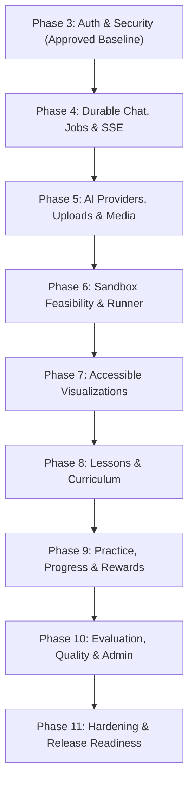

# JavaVerse Integrated Roadmap Audit — Phases 4 Through 11

> [!IMPORTANT]
> **Historical record.** This document describes an earlier repository state and is not the current product specification.

**Status:** APPROVED FOR CONTINUOUS IMPLEMENTATION  
**Date:** 2026-11-05  
**Spec Authority:** Part S (normative override) + Part B + Parts G, I, J, K, L, M, N, O, P, Q, R (Part H retired)  
**Baseline Git Commit:** `5a53fe3` (`Merge branch 'fix/phase-3-ci-lighthouse-home'`, Tag: `phase-3-approved-r1`)  
**Active Working Branch:** `phase/04-chat-jobs-sse`  

---

## A. Final Integrated Architecture

```
                                  +-------------------------------------------------------------+
                                  |                     Client Browser                          |
                                  |  (WCAG 2.2 AA · Light/Dark/System · Responsive Reflow 320px)|
                                  +------------------------------+------------------------------+
                                                                 |
                                              HTTPS (Strict CSP, Nonce, SameSite Cookies)
                                                                 |
                                                                 v
+-------------------------------------------------------------------------------------------------------------------------------+
|                                                    apps/web (Next.js 16.4.x App Router)                                       |
|                                                                                                                               |
|  [Public Routes]             [Auth Routes]             [Dashboard Routes]                     [API Route Handlers v1]         |
|  - / (Landing Hero)          - /auth/login             - /dashboard (Overview)                - /api/v1/health                |
|  - /learn (Preview)          - /auth/bootstrap         - /dashboard/ask (3 Chat Slots)        - /api/v1/readiness             |
|  - /about, /privacy, /terms  - /auth/invitations       - /dashboard/learn (12 Lessons)        - /api/v1/chats/*               |
|                              - /auth/reset             - /dashboard/practice (Problem Bank)   - /api/v1/events (SSE)          |
|                                                        - /dashboard/progress (Mastery, XP)    - /api/v1/uploads               |
|                                                        - /dashboard/library (Search, Notes)   - /api/v1/run (Sandbox)         |
|                                                        - /dashboard/settings                  - /api/v1/lessons/*             |
|                                                        - /dashboard/admin (Owner Console)     - /api/v1/problems/*            |
|                                                                                               - /api/v1/admin/*               |
+-------------------+-----------------------------+-------------------------------+-----------------------------+---------------+
                    |                             |                               |                             |
                    | Direct PostgreSQL           | Ephemeral / RateLimit         | Enqueue / Status            | Private Storage
                    v                             v                               v                             v
+-------------------+-----+   +-------------------+------+   +--------------------+------+   +------------------+-----+
|   PostgreSQL 17         |   |    Redis Cache           |   |     Redis Queue            |   |   Object Storage    |
|   (pgvector, citext)    |   |    (Port 6380)           |   |     (Port 6379, AOF)       |   |   (S3 / MinIO)      |
|   - Sole System of      |   |    - Bounded LRU         |   |     - BullMQ Queues:       |   |   - Quarantine      |
|     Durable Record      |   |    - Rate-limit buckets  |   |       * analysis-queue     |   |   - Clean Media     |
|   - Serializable /      |   |    - Ephemeral tickets   |   |       * media-queue        |   |   - Upload Assets   |
|     Advisory Locks      |   |    - SSE PubSub bridge   |   |       * eval-queue         |   |   - Golden Eval     |
+-------------------+-----+   +--------------------------+   +--------------------+------+   +------------------+-----+
                    ^                                                             |
                    |                                                             v
+-------------------+-------------------------------------------------------------+---------------------------------------------+
|                                                      apps/worker (BullMQ Background Worker)                                   |
|                                                                                                                               |
|   [Analysis Processor]               [Media Sanitization Worker]              [Evaluation Runner]          [Sweeper / Reaper]|
|   - AI Gateway Router                - ClamAV Stream Scanner                  - Golden Dataset Benchmark   - Stale Job Lease |
|   - Structured Zod Validation        - Sharp Normalizer (EXIF Strip)          - Compilation / Run Tests      Reconciliation  |
|   - Sandbox Verification Loop        - PDF / Text Extraction                  - Regression Detection       - Cleanup Tasks   |
|   - SSE Event Persistence            - Safe Storage Relocation                - Quality Reports                              |
+-------------------+-------------------------------------------------------------+---------------------------------------------+
                    |                                                             |
                    v                                                             v
+-------------------+----------------------+                     +----------------+----------------------+
|             AI Provider Layer            |                     |       Isolated Sandbox Runner        |
|  - MockProvider (Deterministic, Local)   |                     |  - container_runner (Primary)        |
|  - AnthropicProvider (Claude 3.5)        |                     |  - MockSandbox (Development fallback)|
|  - GeminiProvider (Gemini 1.5/2.0)       |                     |  - Temurin JDK 8, 11, 17, 21, 25     |
|  - CSPRNG Prompt Delimiter Defense       |                     |  - Dropped Caps, No Network, tmpfs   |
+------------------------------------------+                     +--------------------------------------+
```

---

## B. Cross-Phase Dependency Graph



### Dependency Analysis:
1. **Phase 4 (Durable Chat, Jobs, SSE)**:
   - *Requires*: Phase 3 sessions, CSRF, rate-limiting, and correlation context.
   - *Provides*: Reliable chat slot allocation (1..3), message persistence, BullMQ job enqueue/state machine, and user-level SSE multiplexing (`user_stream_events`).
2. **Phase 5 (AI Providers, Uploads, Media)**:
   - *Requires*: Phase 4 job processing pipeline and storage foundation.
   - *Provides*: Provider-neutral AI gateway (`MockProvider`, `AnthropicProvider`, `GeminiProvider`), Zod output schemas, and quarantined media processing worker.
3. **Phase 6 (Sandbox Feasibility & Runner)**:
   - *Requires*: Phase 4 job dispatch and Phase 5 code generation output.
   - *Provides*: Isolated code execution (`container_runner` / `mock`), compilation, test runner, and verification status (`VERIFIED` / `UNVERIFIED`).
4. **Phase 7 (Accessible Visualizations)**:
   - *Requires*: Phase 5 `VisualizationSpec` output schemas and Phase 6 verified code state.
   - *Provides*: 12 launch-critical 2D visualization kinds, 1 signature 3D JVM memory scene, playback engine, and WCAG 2.2 AA accessible equivalents.
5. **Phase 8 (Lessons & Curriculum)**:
   - *Requires*: Phase 7 visualization player and Phase 6 sandbox execution.
   - *Provides*: 12 complete interactive lessons across Foundations, OOP, DSA, and Advanced Java, quizzes, and lesson-to-chat context.
6. **Phase 9 (Practice, Progress, Rewards)**:
   - *Requires*: Phase 8 curriculum concepts and Phase 6 sandbox execution.
   - *Provides*: Problem bank, Monaco test runner, idempotent XP/streak/badge calculation, and spaced-repetition flashcards.
7. **Phase 10 (Evaluation, Quality, Admin)**:
   - *Requires*: Phase 5 AI gateway, Phase 6 sandbox, and Phase 9 practice results.
   - *Provides*: 50+ golden evaluation suite, regression gates, PII-scrubbed knowledge-base candidates, and owner management console.
8. **Phase 11 (Hardening & Release Readiness)**:
   - *Requires*: All previous phases.
   - *Provides*: Complete security audits, backup/restore verification, load testing, Lighthouse CI, and release checklists.

---

## C. Feature Ownership Matrix

| Feature | Owning Phase | Interface / Foundation Delivered | Prohibited In Early Phases |
| :--- | :---: | :--- | :--- |
| **Chat Slot Management** | **Phase 4** | `chats` table, slot 1..3 constraint, delete-and-replace | Real LLM calls, sandbox execution |
| **Durable Jobs & State Machine** | **Phase 4** | `durable_jobs`, lease renewal, worker crash recovery | Non-mock AI processing |
| **Resumable SSE Streaming** | **Phase 4** | `user_stream_events`, `Last-Event-ID` cursor, heartbeat | WebSockets, unauthenticated streams |
| **Provider-Neutral AI Gateway** | **Phase 5** | `AIProvider`, structured output, prompt delimiters | Live user training, browser AI calls |
| **Upload Quarantine & Media** | **Phase 5** | `attachments`, ClamAV, Sharp re-encoding, OCR | Decoding in web process, SVG uploads |
| **Isolated Code Sandbox** | **Phase 6** | `SandboxClient`, multi-JDK execution, resource limits | Execution in web/worker, root containers |
| **Concept Visualizations** | **Phase 7** | 12 2D kinds, 1 3D scene, scrubber, accessible tables | Model-generated executable scripts |
| **12 Core Java Lessons** | **Phase 8** | Tracks, modules, quizzes, coding challenges | Fabricated completion, external scraping |
| **Practice & Gamification** | **Phase 9** | Problem bank, idempotent XP, streaks, badges | Client-authoritative rewards |
| **Evaluation & KB Management** | **Phase 10** | Golden evaluation suite, candidate PII scrub, Admin | Private evaluation data in prompts |
| **Production Release & Hardening**| **Phase 11** | Backup/restore, load test, Lighthouse, CSP, runbooks | Unverified production claims |

---

## D. Schema Roadmap

| Table | Phase Added / Extended | Key Invariants & Constraints |
| :--- | :---: | :--- |
| `chats` | Phase 1 (Extended Phase 4) | `slot BETWEEN 1 AND 3`, `UNIQUE(user_id, slot)` |
| `chat_state` | Phase 1 (Extended Phase 4) | `chat_id` PK, `ui_state` JSONB |
| `messages` | Phase 1 (Extended Phase 4) | `chat_id` FK, `role IN ('user', 'assistant', 'system')` |
| `durable_jobs` | Phase 1 (Extended Phase 4) | `status IN ('PENDING', 'RUNNING', 'COMPLETED', 'FAILED', 'CANCELLED')`, lease index |
| `user_stream_events` | Phase 1 (Extended Phase 4) | `stream_seq BIGSERIAL PK`, `(user_id, stream_seq)` index |
| `attachments` | Phase 1 (Extended Phase 5) | `scan_status IN ('PENDING', 'CLEAN', 'INFECTED', 'REJECTED')` |
| `analyses` | Phase 1 (Extended Phase 5) | `verification_status IN ('UNVERIFIED', 'VERIFIED', 'FAILED')` |
| `executions` | Phase 1 (Extended Phase 6) | `code_hash`, `runner_provider`, stdout/stderr bounds |
| `curriculum_lessons` | **Phase 8 (New)** | `slug` UNIQUE, `track`, `module`, `published`, `order_index` |
| `practice_problems` | **Phase 9 (New)** | `slug` UNIQUE, `difficulty`, `topic`, hidden tests JSONB |
| `practice_submissions`| **Phase 9 (New)** | `(user_id, problem_id, created_at)`, `status` |
| `user_progress` | **Phase 9 (New)** | `UNIQUE(user_id, item_type, item_id)`, `completed` |
| `user_rewards` | **Phase 9 (New)** | `user_id` FK, `xp`, `streak_days`, `last_activity_date` |
| `user_badges` | **Phase 9 (New)** | `UNIQUE(user_id, badge_key)` |
| `kb_items` | **Phase 10 (New)** | `status IN ('CANDIDATE', 'APPROVED', 'REJECTED')`, tsvector search |
| `eval_runs` | **Phase 10 (New)** | `run_id`, `dataset_version`, `model_id`, pass rates |

---

## E. Package and Dependency Roadmap

1. **Phase 4**:
   - Monorepo packages: `@javaverse/db`, `@javaverse/observability`, `@javaverse/schemas`, `@javaverse/security`, `apps/web`, `apps/worker`.
   - Dependencies: `bullmq`, `ioredis` (already approved and present). No new third-party dependencies required.
2. **Phase 5**:
   - Dependencies: `@anthropic-ai/sdk` (optional adapter), `@google/genai` (optional adapter), `sharp` (pinned >= 0.35.5 in worker), `@aws-sdk/client-s3`.
3. **Phase 6**:
   - Dependencies: internal `container_runner` using Docker daemon API or mock runner.
4. **Phase 7**:
   - Dependencies: `three` (pinned, self-contained for 3D JVM scene), `lucide-react` (already present). Zero speculative visualization frameworks.
5. **Phase 8 - 11**:
   - Standard internal modules, `@prisma/client`, and vitest/playwright test suites.

---

## F. API, Worker and Event Contracts

1. **Chat & Message Submission**:
   - `POST /api/v1/chats/:id/messages` -> atomically creates `Message` (`status: PROCESSING`) and `DurableJob` (`status: PENDING`), returns `202 Accepted` with `{ messageId, jobId }`.
2. **SSE Streaming**:
   - `GET /api/v1/events` -> Streams `UserStreamEvent` rows with `id: <stream_seq>`.
   - Format:
     ```text
     id: 1042
     event: stage_changed
     data: {"jobId":"...","stage":"choosing_technique","progress":35}
     ```
3. **Sandbox Execution Contract**:
   - Input: `{ code: string, javaVersion: "21", stdin?: string, timeoutMs?: number }`.
   - Output: `{ stdout: string, stderr: string, exitCode: number, timeMs: number, memoryKb: number, status: "SUCCESS" | "TIMEOUT" | "ERROR" }`.

---

## G. Integrated Threat Model

1. **Cross-User Data Access (IDOR)**: Every database query filters strictly by authenticated `session.userId`. Chat slot, message, execution, and stream event ownership verified on every read and write.
2. **Queue Flooding & Resource Exhaustion**: Token bucket rate limits enforced on message creation and code execution; maximum 3 active chat slots per user; max 3 concurrent SSE connections per user.
3. **Malicious Code Execution**: Learner code executed exclusively inside isolated sandbox (`container_runner` / `mock`) with dropped capabilities, no network access, memory limits, and timeouts. Web and worker processes never execute untrusted code.
4. **Prompt Injection & Media Exploits**: User input wrapped in per-request CSPRNG delimiters; untrusted images sanitized and re-encoded by isolated media worker; SVG uploads disabled.
5. **Reward & Gamification Tampering**: Client cannot authoritatively grant XP or badges; all rewards derived strictly server-side inside PostgreSQL transactions.

---

## H. Acceptance Criteria Summary

Every phase must execute unit tests, integration tests against real PostgreSQL and Redis, and browser accessibility checks before advancing.

---

**AUDIT CONCLUSION:** The architecture is verified, interfaces are cohesive, and there are no blocking contradictions. Continuous execution of Phases 4 through 11 is authorized.

